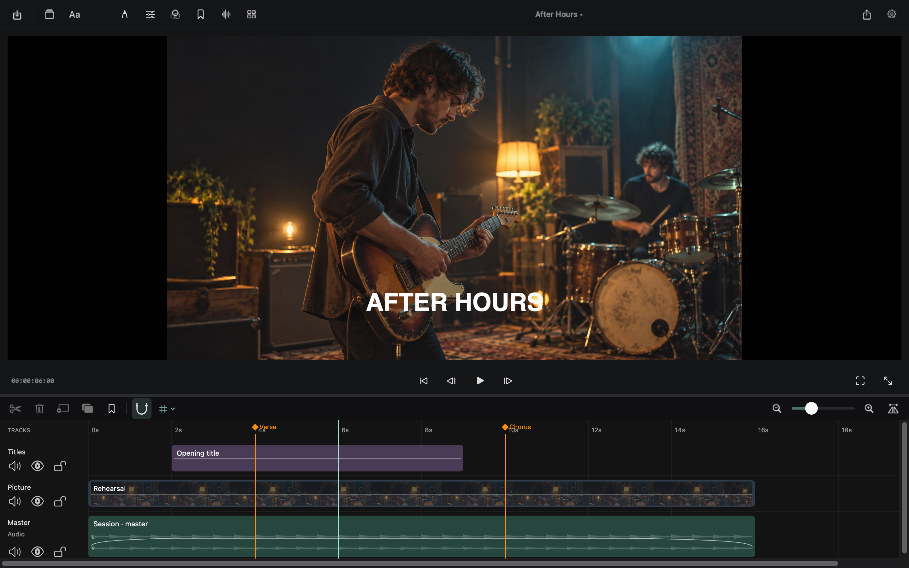
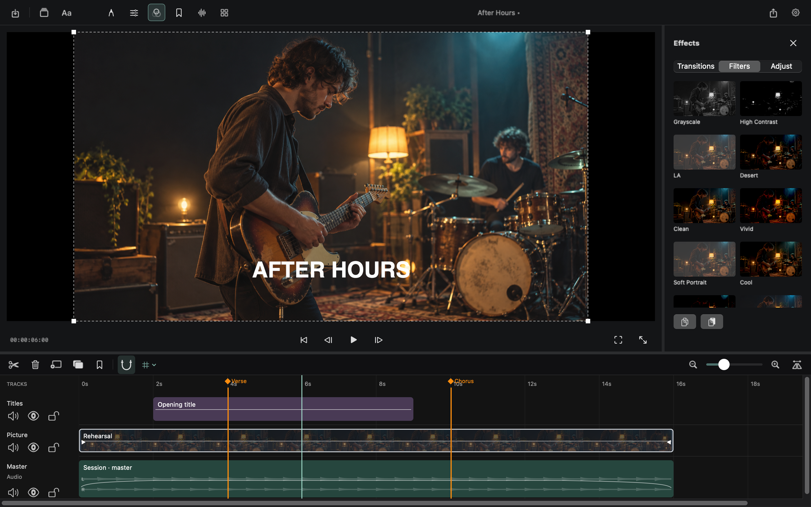
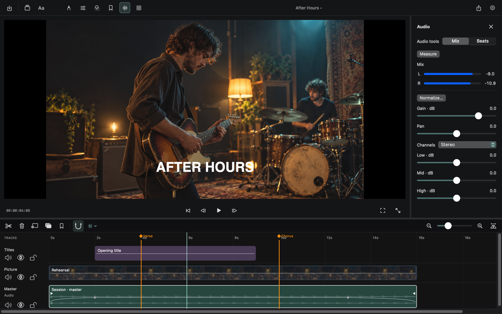

# Life Editor

[](https://github.com/3nboyd/life-editor/actions/workflows/ci.yml)


[](LICENSE)

A native Mac video editor with a large viewer, layered timeline and direct editing.
Local media, local rendering. No account, subscription, upload or watermark.



**Pre-1.0 development · Apple Silicon · macOS 15+**

[Build from source](#build) · [Progress](docs/PROGRESS.md) · [Current status](docs/STATUS.md) · [Full roadmap](docs/ROADMAP.md) · [Verification](docs/VERIFICATION.md)

## A quiet workspace

The viewer stays large. Panels appear when needed; the timeline keeps pictures,
audio and titles together. Volume handles and automation points edit one envelope.

| Original looks | Audio and automation |
|---|---|
|  |  |

Native view captures use fictional, generated rehearsal imagery and a rendered
poster frame in place of the hardware video layer. The controls and timeline are
the application's own views. [Capture details and reproduction](docs/screenshots/README.md).

## Build

```sh
scripts/build-app.sh
open 'dist/Life Editor.app'
```

A Swift 6 toolchain/macOS SDK is required. Source builds use ad-hoc signing and do
not need distribution credentials. Optional broad-format helpers are built from
verified LGPL source, never taken from Homebrew:

```sh
scripts/build-ffmpeg.sh
scripts/build-app.sh
```

When present, the complete helper tree (matching source, licenses, configuration,
inventory) is bundled. See [FFmpeg build and provenance](docs/FFMPEG.md).

## Current editing paths

### Editing

- Layered video/audio/still import, playback, scrubbing and frame stepping.
- Move/trim/split/duplicate/delete/ripple-delete with source/overlap protection.
- Multi-selection, linked/group moves, clipboard and editable vector drawings/shapes.
- Marker notes, ranges, and colors; markers can follow their original source frames when clips are trimmed or their speed changes.
- Crop, position, scale, rotation, flips and non-exported safe-area guides.
- Cached per-channel waveforms with exact source-rate sample detail when zoomed in.
- Autosave after editing pauses, recent projects, project duplication, and confirmation before reverting.

### Titles and effects

- Fourteen transitions that stay within the available footage, with duration handles on the timeline.
- Direct volume/opacity points, grouped point editing, shared fades, curves, constant speed and pitch lock.
- Editable multiline titles, six entrances, colors/backgrounds/outlines and viewer handles.
- Shared color wheel, RGB/HEX, swatches and viewer sampling.
- Sixteen original visual looks, tonal adjustments and real media thumbnails.

### Audio and multicam

- Musical grids with swing/anchors, tap tempo, background onset/tempo analysis.
- Gain/pan/channel mapping/EQ, optional limiter and calibrated loudness measurement.
- Multicam groups with four lightweight camera previews, suggested audio-waveform alignment, and manual timing offsets.
- Reviewed clock-drift correction with source/master anchors, preview and one-step undo.
- Continuous master audio by default; switch video, audio, or both, replace cuts within a selected range, and preview camera choices.
- Drag video/audio decision boundaries directly in the timeline, with a ghost preview, snapping and one-action undo.

### Export and project recovery

- SRT import/export and timed captions; portable collected packages and recovery.
- H.264/HEVC/ProRes/WAV/AIFF/M4A export, ranges, progress and cancellation.

Every export consumes a snapshot and the same compositor as preview. Rational
project times retain sample/frame precision. Normal moves preserve gaps; a
same-track collision is rejected instead of silently overwriting material.

These features are implemented, with broader workflow and usability testing still
in progress. See the [development status](docs/STATUS.md),
[test results](docs/VERIFICATION.md), and [roadmap](docs/ROADMAP.md).

## Tests

```sh
scripts/test.sh
LIFE_RUN_MEDIA_INTEGRATION=1 scripts/test.sh
```

Native tests generate synthetic media and check decoded preview/export frames,
retiming sample count/pitch/fades, camera cuts, creative effects, actual codecs,
selected ranges and cancellation safety. The UI render check exercises 1280 × 800;
it does not substitute for hands-on usability or accessibility testing.

## Shortcuts

| Action | Shortcut |
|---|---|
| Import / Open / Save | ⌘I / ⌘O / ⌘S |
| Save As | ⇧⌘S |
| Play/pause / frame step | Space / ← → |
| Split / delete | ⌘B / Delete |
| Duplicate / ripple delete | ⌘D / ⇧Delete |
| Marker / snapping | M / N |
| Bypass snap during drag | Option |
| Viewer focus | ⇧⌘F |
| Undo / redo | ⌘Z / ⇧⌘Z |
| Visible multicam angles | 1–4 |

[Architecture](docs/ARCHITECTURE.md) · [Contributing](CONTRIBUTING.md) ·
[Dependencies](docs/DEPENDENCIES.md) · [Formats](docs/FORMATS.md)
